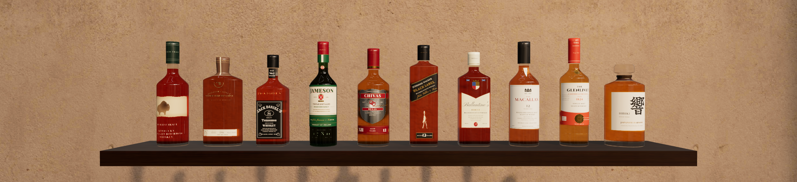

# Gôndola 3D · Whisky

Gôndola de loja em **3D fotorrealista** feita com **three.js**, com texturas PBR do
**Poly Haven** em **KTX2** (cor + **normal map** + AO/roughness), **sombras via shadow map**, luz
quente com **retroiluminação âmbar** e uma **tela interativa** no cabeçote. As 10 garrafas e
rótulos foram **recriados a partir de fotos de referência** (formato, cor do líquido, cápsula e
composição do rótulo). Os dados vêm de um **JSON** com o campo booleano `disponivel`; um
**painel lateral em estilo country sóbrio e executivo** mostra descrição, harmonização e disponibilidade, e as prateleiras
**se reorganizam sozinhas** quando falta uma bebida.

Projeto da *Atividade Prática SENAI — Engenharia de Prompt para Expositores de Mercado*
(nicho: Bebidas), especificado com **[Spec Kit](https://github.com/github/spec-kit)**.




## Como rodar

Requisitos: **Python 3.9+** e um navegador com WebGL2 (Chrome, Edge, Firefox ou Safari atuais).
Não precisa de `npm install` — as bibliotecas já estão em `vendor/` e as texturas em `assets/`.

```bash
git clone -b develop https://github.com/MoraesNico/gondola.git
cd gondola
python serve.py            # no Linux/macOS pode ser python3
```

O navegador abre em `http://127.0.0.1:8000`. Opções:

| Comando | Efeito |
|---|---|
| `python serve.py --port 9000` | outra porta |
| `python serve.py --host 0.0.0.0` | acessível por um tablet na mesma rede (mostra o IP) |
| `python serve.py --no-browser` | não abre o navegador |
| `python serve.py --quiet` | não registra cada requisição |

> Abrir o `index.html` direto (file://) não funciona: módulos ES e o carregamento de JSON/texturas
> exigem HTTP. O `serve.py` resolve isso com os tipos MIME corretos (inclusive `.ktx2`, `.wasm` e
> `.woff2`). Catálogo e código vão sem cache (editar o JSON e recarregar mostra o novo arranjo);
> texturas, fontes e bibliotecas são revalidadas (resposta 304, sem baixar de novo).

### Parâmetros de URL

| URL | Efeito |
|---|---|
| `?perf` | painel de desempenho: quadros, draw calls, triângulos, texturas, nível de qualidade |
| `?lineup` | as 10 garrafas lado a lado, para comparar com as fotos de referência |
| `?quality=low` · `medium` · `high` | fixa o nível de qualidade (por padrão ele se ajusta sozinho) |
| `?textures=jpg` | ignora o KTX2 e usa os JPG (para comparar memória/qualidade) |

## Usando

| Ação | Como |
|---|---|
| Girar / aproximar / deslocar | arrastar · roda do mouse ou pinça · botão direito/dois dedos |
| Ver um produto | clicar numa garrafa **ou** abrir o card no painel → **Ver na gôndola** |
| Remover / repor prateleira | botões no card (vale para a sessão; o JSON não é alterado) |
| Voltar ao estado do JSON | **Restaurar prateleiras do JSON** |
| Filtrar a lista | Todos · Disponíveis · Na gôndola |
| Ajustar a luz | painel **Iluminação** (canto inferior esquerdo): spot, preenchimento, LEDs (modo assado ou realista), sombras, exposição |
| Vista geral | botão **Vista geral** |

| Detalhe do produto | Arranjo com 1 módulo | LEDs em destaque |
|---|---|---|
|  |  |  |

## Catálogo (`data/whiskies.json`)

| # | Whisky | Tipo | Garrafa e rótulo (recriados das fotos) |
|---|---|---|---|
| 1 | Buffalo Trace | Kentucky Straight Bourbon | redonda; faixa de papel rasgado com bisão; nome impresso no vidro |
| 2 | Woodford Reserve | Kentucky Straight Bourbon (Small Batch) | frasco achatado; medalhão WR e nome dourados no vidro; ticket de lote |
| 3 | Jack Daniel's Old No. 7 | Tennessee Whiskey | quadrada; rótulo preto com filigrana; gargantilha "Old No.7"; relevo no ombro |
| 4 | Jameson | Blended Irish Whiskey | vidro verde; cápsula vermelha e verde; selo JJ&S; brasão |
| 5 | Chivas Regal 12 | Blended Scotch | redonda larga; escudo prateado com faixa bordô; "XII · Aged 12 years" |
| 6 | Johnnie Walker Black Label | Blended Scotch | quadrada; faixa preta a 24°; homem caminhando; selo "12" |
| 7 | Ballantine's Finest | Blended Scotch | retangular; papel creme com corte em "V"; brasão; selo "B" |
| 8 | The Macallan 12 Double Cask | Single Malt (Speyside) | redonda alta; rótulo branco; castelo; triângulo "12 years old" |
| 9 | The Glenlivet Caribbean Reserve | Single Malt (Speyside) | redonda esbelta; cápsula laranja; faixa com medalhão |
| 10 | Hibiki Japanese Harmony | Japanese Blended | 24 facetas; rolha de vidro; papel washi com 響 |

> "Alan Walker" foi interpretado como **Johnnie Walker** e "Macalan" como **The Macallan**.
> O **Hibiki começa com `"disponivel": false`** para demonstrar o arranjo automático — troque para
> `true`, salve e recarregue a página: a gôndola passa de 9 para 10 prateleiras (5 + 5).

Cada produto segue o contrato [`whiskies.schema.json`](specs/002-otimizacao-rotulos-country/contracts/whiskies.schema.json) (v2):

```json
{
  "id": "buffalo-trace",
  "ordem": 1,
  "nome": "Buffalo Trace",
  "tipo": "Kentucky Straight Bourbon",
  "pais": "Estados Unidos",
  "teorAlcoolico": 45,
  "preco": 279.9,
  "descricao": "Bourbon da destilaria mais antiga em operação contínua dos EUA…",
  "notas": ["baunilha", "caramelo", "toffee"],
  "harmonizacao": ["costela defumada", "torta de nozes-pecã"],
  "disponivel": true,
  "garrafa": {
    "formato": "redonda", "altura": 0.3, "largura": 0.084, "ombro": [0.58, 0.71],
    "raioGargalo": 0.0145, "fundo": 0.03,
    "capsula": { "inicio": 0.79, "cor": "#1c3128", "metalica": false },
    "corVidro": "#f4f1ea", "corLiquido": "#d0561c"
  },
  "rotulo": { "estilo": "buffalo-trace", "destaque": "#b4471b" }
}
```

Silhueta, ombro, gargalo, fundo de vidro, cápsula ou rolha de vidro, cor do vidro e do whisky,
estilo do rótulo e cor de destaque na interface vêm do JSON. O código só tem os *templates* de
desenho de cada estilo; um estilo desconhecido cai no rótulo genérico.

### Regras de validação (interação do cliente)

1. **RV-01 · Disponibilidade é soberana** — `disponivel: false` não ocupa prateleira e não pode ser reposto pela interface.
2. **RV-02 · Mínimo de uma prateleira** — a última prateleira visível não pode ser removida.
3. **RV-03 · Integridade do catálogo** — itens sem `id` único, `nome`, `descricao`, `preco ≥ 0`, `teorAlcoolico` 0–100 ou com `disponivel` não booleano são ignorados e sinalizados no painel.

### Arranjo automático

Calculado por [`src/core/layout.js`](src/core/layout.js) (sem three.js, testado com `node --test`):

- entram os produtos com `disponivel: true` que não foram removidos na sessão, na `ordem` do JSON;
- módulos de **1 m** com até **5 prateleiras**: `módulos = ⌈n / 5⌉`, distribuição equilibrada (ex.: 9 → 5 + 4);
- dentro do módulo, de cima para baixo, com espaçamento uniforme (máx. 42 cm) centralizado na altura útil;
- se sobra um módulo vazio, a gôndola encolhe; a cena anima tudo em ~1 s e a câmera reenquadra.

## Rótulos fiéis às referências

As fotos das garrafas enviadas pelo cliente serviram **só de referência**: formato, cor do
líquido, cápsula e composição do rótulo. Elas não viraram textura nem estão no repositório,
porque são imagens de terceiros. A análise, com as cores medidas em cada foto, está em
[docs/referencias/rotulos.md](docs/referencias/rotulos.md).

- **Templates por marca** ([`src/scene/labelArt.js`](src/scene/labelArt.js)) desenham cada rótulo
  em canvas com tipografia equivalente (Cinzel, Playfair Display, Rye, Pinyon Script, Cormorant
  Garamond e Yuji Syuku para o 響), a paleta medida e emblemas vetoriais simplificados (bisão,
  brasões, homem caminhando, castelo, nó do Chivas).
- **Peças do rótulo**: rótulo principal, faixa inferior, gargantilha, medalhão, impressão e
  relevo no vidro, etiqueta triangular no ombro e cápsula do gargalo em 360°.
- **Desenho em espaço físico**: cada peça recebe a proporção real (arco × altura) na garrafa,
  então as letras não distorcem. Os textos principais ficam na faixa frontal visível.
- **Foil automático**: pixels dourados ou prateados viram metal brilhante no atlas de dados.
  Papel creme fica fosco.
- **Whisky de verdade**: o próprio vidro transmissivo é tingido pela cor do whisky (cor por
  vértice) entre o fundo grosso e a linha de enchimento. O fundo da loja aparece através do
  âmbar, como na foto do produto. Jameson tem vidro verde (cor por instância). Hibiki tem 24
  facetas e rolha de vidro.

## Desempenho

Aplicando o [guia de otimização three.js r186](docs/referencias/otimizacao-threejs.md). Os números
vêm de `node tests/perf.mjs` na vista geral, num quadro completo com sombras e transmissão:

| Métrica | v1 | v2 | |
|---|---|---|---|
| Draw calls por quadro | 277 | **40** | −86% |
| Memória de texturas na GPU | 261 MiB | **116 MiB** | −56% |
| Luzes ativas | 13 | **3** | −10 RectAreaLight |
| Triângulos por quadro | 660 k | 556 k | −16% |
| Download das texturas PBR | 19 MB JPG | 11 MB KTX2 | −42% |

| Dica do guia | Aplicação |
|---|---|
| 31–35 instancing, batching, atlas | todas as garrafas, rótulos, cápsulas e etiquetas em **2 `BatchedMesh`** com um atlas único; tampos, ferragens, fitas LED, colunas e laterais em `InstancedMesh`; metal de cada módulo fundido |
| 22, 27, 28 texturas | **KTX2** (ETC1S para cor e ARM, UASTC + RDO para normal) com `KTX2Loader.detectSupport`; o JPG é o fallback. O atlas de dados usa meia resolução |
| 53, 55 luzes | LEDs **assados**: lightmap nos tampos e faixas de retroiluminação emissivas no fundo, redesenhadas no rearranjo. As 10 `RectAreaLight` ficam como modo "realista" opcional |
| 58, 60, 61 sombras | `shadow.autoUpdate = false` por luz, atualizando só quando algo muda; preenchimento sem sombra por padrão; frustum ajustado à largura da gôndola; `receiveShadow` só onde cai sombra |
| 5 shaders | `renderer.compileAsync` com o carregamento ainda na tela |
| 68, 80 qualidade | níveis alta, média e baixa (pixel ratio, sombra, resolução da transmissão) trocados pela média de quadros, com histerese de 3 trocas ([`src/core/quality.js`](src/core/quality.js), testado) |
| 85 pré-carga | `modulepreload` dos módulos e `preload` das fontes; HDRI e texturas carregam em paralelo |
| 94 medir | `?perf` e `tests/perf.mjs` |
| 98 robustez | perda de contexto WebGL mostra aviso e recarrega a página quando o contexto volta |
| — transmissão | `transmissionResolutionScale = 0.5` (o vidro é fino, meia resolução não aparece) |

> Mantivemos o `WebGLRenderer`. O guia recomenda migrar para WebGPU só ao bater em limites de
> desempenho (dicas 6, 8 e 9), e a meta de draw calls foi atingida com batching. As medições
> rodaram sem GPU (Chromium com SwiftShader): as contagens são comparáveis, mas não há fps de
> hardware real.

## Iluminação e materiais

| Superfície | Textura Poly Haven (CC0) | Mapas |
|---|---|---|
| Prateleiras e laterais | `lacquered_cherry_wood` (2k) + verniz (clearcoat) | diff · nor_gl · arm |
| Painel de fundo | `black_painted_planks` (2k), ripado vertical, retroiluminado | diff · nor_gl · arm |
| Colunas, base, cabeçote | `blue_metal_plate` (1k) com cor grafite | nor_gl · arm |
| Piso | `marble_01` (2k) polido | diff · nor_gl · arm |
| Parede | `painted_plaster_wall` (1k), tom quente | diff · nor_gl · arm |
| Reflexos e luz ambiente | HDRI `brown_photostudio_02` (1k) via PMREM | — |

- **Luz quente de adega**: spot principal a ≈ 2900 K com sombra PCF 2048², preenchimento a
  ≈ 3500 K, hemisférica âmbar, LEDs a ≈ 2900 K e retroiluminação âmbar atrás de cada prateleira.
- **Normal map** em convenção OpenGL e mapa **ARM** empacotado (AO, roughness e metalness em R,
  G e B); UVs em metros, com escala física igual em todas as faces.
- Tone mapping ACES (AgX e Neutral no painel), saída sRGB, unidades físicas de luz.

Para baixar de novo as texturas: `python scripts/fetch_polyhaven.py`. Para regenerar os KTX2:
`npm i --no-save ktx2-encoder@0.6.0 && node scripts/build_ktx2.mjs --force`. Para baixar as
fontes: `python scripts/fetch_fonts.py`.

## Interface

Estética **country sóbria e executiva**, como a de um clube de campo ou de um escritório de
fazenda de alto padrão: linho `#f3ede2` e papel creme, couro conhaque `#7a4a2a`, verde-floresta
`#2f4a3a` e latão `#a8874a` só em filetes finos. A tipografia americana clássica faz o sotaque
country: **Cormorant Garamond** nos títulos, **Libre Franklin** no texto e nos versaletes, e
**Zilla Slab** nos números. Todas são OFL e servidas localmente. Não há clichês de faroeste
(cordas, estrelas, ferraduras ou fontes de cartaz); a fonte Rye aparece só no rótulo do Jack
Daniel's, porque reproduz a referência real. A cor de cada marca (`rotulo.destaque`) aparece
numa faixa lateral do card. O painel numera os rótulos, mostra os dados em tabela e indica
módulo e prateleira de cada produto. Painel de iluminação, carregamento, avisos, etiquetas de
preço e a tela do cabeçote seguem a mesma linguagem.

## Estrutura

```text
index.html              página + importmap (three, addons, camera-controls)
serve.py                servidor local (biblioteca padrão do Python)
data/whiskies.json      catálogo dos 10 whiskies (campo disponivel)
src/
  main.js               bootstrap: JSON → arranjo → cena → interface
  state.js              estado da sessão (removidos, seleção, filtro)
  core/catalog.js       validação do JSON (RV-03)            ← lógica pura, testada
  core/layout.js        arranjo das prateleiras (RV-01/02)   ← lógica pura, testada
  core/quality.js       níveis de qualidade adaptativa       ← lógica pura, testada
  scene/bottles.js      garrafas procedurais em 2 BatchedMesh
  scene/labelArt.js     templates de rótulo por marca (canvas)
  scene/atlas.js        atlas único de rótulos (cor + dados de material)
  scene/                renderer, materiais KTX2, ambiente, luzes, gôndola, tela, HUD
  ui/                   painel lateral, painel de iluminação, CSS country executivo
assets/textures/        Poly Haven: .ktx2 (usado) + .jpg (fallback e fonte)
assets/fonts/           fontes OFL (woff2) + fonts.css + licenças
vendor/                 three.js 0.186.1 (+ KTX2Loader e transcoder Basis), camera-controls 3.1.2, lil-gui
scripts/                fetch_polyhaven.py, fetch_fonts.py, build_ktx2.mjs
specs/001-…/ 002-…/     artefatos do Spec Kit (versão 1 e atualização)
docs/                   engenharia de prompt, referências e capturas de tela
tests/                  node --test, unittest, smoke test e medição de desempenho (Playwright)
```

## Spec Kit

O projeto foi iniciado com `specify init --here --integration claude` e seguiu o fluxo
**constituição → especificação → plano → tarefas → implementação**:

| Artefato | Conteúdo |
|---|---|
| [.specify/memory/constitution.md](.specify/memory/constitution.md) | v1.1.0 — 6 princípios: dados dirigem a cena, PBR, zero build, lógica pura testável, performance medida, fidelidade às referências |
| [spec.md](specs/001-gondola-whisky-3d/spec.md) | 4 histórias de usuário, requisitos FR-001…013, regras RV-01…03, fluxo de 4 telas, critérios de sucesso |
| [plan.md](specs/001-gondola-whisky-3d/plan.md) | contexto técnico, verificação da constituição, estrutura |
| [research.md](specs/001-gondola-whisky-3d/research.md) | decisões R1–R10 (motor, cor, sombras, texturas, garrafas, LEDs, câmera…) |
| [data-model.md](specs/001-gondola-whisky-3d/data-model.md) · [contracts/](specs/001-gondola-whisky-3d/contracts/) | entidades, schema JSON, contrato dos módulos |
| [tasks.md](specs/001-gondola-whisky-3d/tasks.md) | 34 tarefas por fase e história de usuário |
| [quickstart.md](specs/001-gondola-whisky-3d/quickstart.md) | roteiro de validação manual |
| [specs/002-otimizacao-rotulos-country/](specs/002-otimizacao-rotulos-country/) | atualização: spec (US1–US4, FR-101…110), plano, pesquisa R11–R19 com resultados medidos, contrato JSON v2, 26 tarefas |

As skills `/speckit-*` ficam em `.claude/skills/` para continuar a evolução (ex.: `/speckit-specify`
para uma nova funcionalidade). A documentação dos prompts da atividade está em
[docs/engenharia-de-prompt.md](docs/engenharia-de-prompt.md).

## Testes

```bash
node --test                                             # catálogo + arranjo (Node 18+)
python -m unittest discover -s tests -p "test_*.py"     # serve.py
npm i -D playwright && npx playwright install chromium  # opcional
node tests/smoke.mjs                                    # navegador: fluxo completo + capturas
node tests/perf.mjs                                     # draw calls, triângulos, memória de textura
```

## Créditos e licenças

- Texturas e HDRI: [Poly Haven](https://polyhaven.com) — **CC0**.
- [three.js](https://threejs.org) (MIT) com transcodificador [Basis Universal](https://github.com/BinomialLLC/basis_universal) (Apache 2.0), [camera-controls](https://github.com/yomotsu/camera-controls) (MIT), [lil-gui](https://lil-gui.georgealways.com) (MIT) — licenças em `vendor/`.
- Fontes: Cormorant Garamond, Libre Franklin, Zilla Slab, Archivo, IBM Plex Mono, Cinzel,
  Playfair Display, Rye, Pinyon Script e Yuji Syuku (subset), todas sob a **SIL Open Font
  License**, com as licenças em `assets/fonts/`.
- Marcas citadas pertencem aos seus donos. Os rótulos são recriações procedurais, inspiradas na
  identidade visual real, feitas para um projeto acadêmico sem fins comerciais. Fotos de produto
  não são usadas como textura. Preços são ilustrativos.
