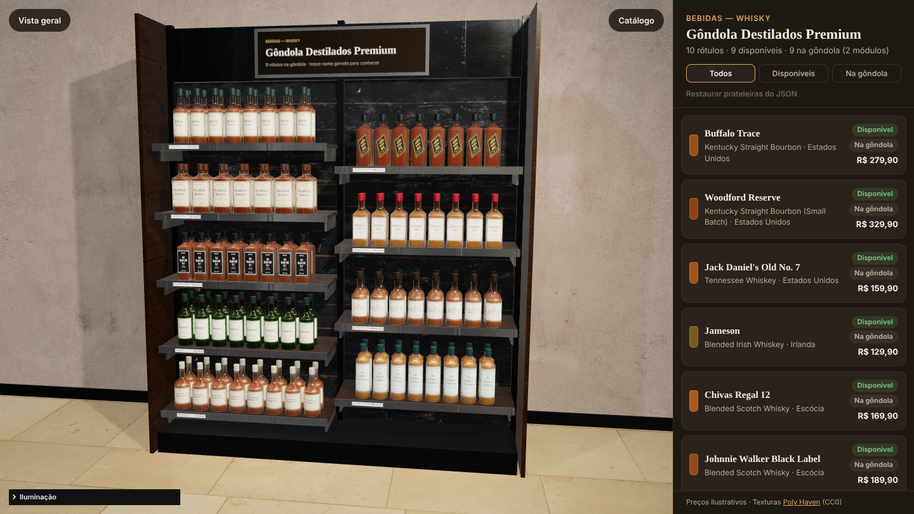
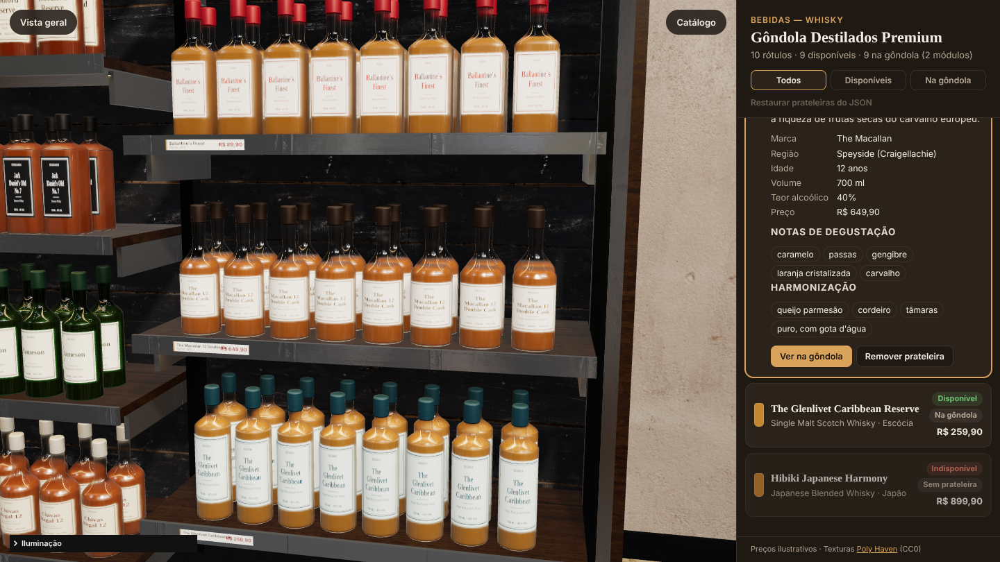
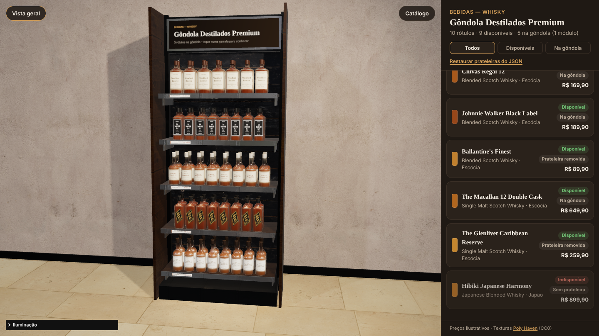
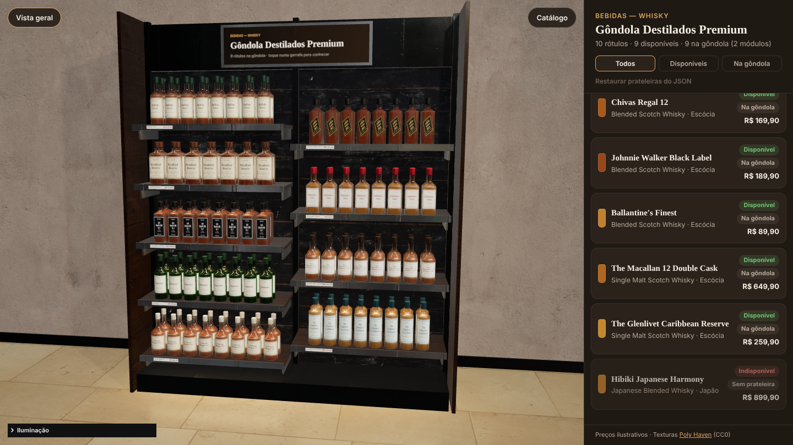

# Gôndola 3D · Whisky

Gôndola de loja em **3D fotorrealista** feita com **three.js**, com texturas PBR do
**Poly Haven** (cor + **normal map** + AO/roughness), **sombras via shadow map**, fitas **LED** em
cada prateleira e uma **tela interativa** no cabeçote. Os 10 whiskies vêm de um **JSON** com o
campo booleano `disponivel`; um **painel lateral** mostra descrição, harmonização e
disponibilidade, e as prateleiras **se reorganizam sozinhas** quando falta uma bebida.

Projeto da *Atividade Prática SENAI — Engenharia de Prompt para Expositores de Mercado*
(nicho: Bebidas), especificado com **[Spec Kit](https://github.com/github/spec-kit)**.



## Como rodar

Requisitos: **Python 3.9+** e um navegador com WebGL2 (Chrome, Edge, Firefox ou Safari atuais).
Não precisa de `npm install` — as bibliotecas já estão em `vendor/` e as texturas em `assets/`.

```bash
git clone -b develop https://github.com/MoraesNico/gondola.git
cd gondola
python serve.py            # no Linux/macOS pode ser python3
```

O navegador abre em `http://127.0.0.1:8000`. Opções:

| Comando | Efeito |
|---|---|
| `python serve.py --port 9000` | outra porta |
| `python serve.py --host 0.0.0.0` | acessível por um tablet na mesma rede (mostra o IP) |
| `python serve.py --no-browser` | não abre o navegador |
| `python serve.py --quiet` | não registra cada requisição |

> Abrir o `index.html` direto (file://) não funciona: módulos ES e o carregamento de JSON/texturas
> exigem HTTP. É exatamente isso que o `serve.py` resolve, com os tipos MIME corretos e sem cache.

## Usando

| Ação | Como |
|---|---|
| Girar / aproximar / deslocar | arrastar · roda do mouse ou pinça · botão direito/dois dedos |
| Ver um produto | clicar numa garrafa **ou** abrir o card no painel → **Ver na gôndola** |
| Remover / repor prateleira | botões no card (vale para a sessão; o JSON não é alterado) |
| Voltar ao estado do JSON | **Restaurar prateleiras do JSON** |
| Filtrar a lista | Todos · Disponíveis · Na gôndola |
| Ajustar a luz | painel **Iluminação** (canto inferior esquerdo) |
| Vista geral | botão **Vista geral** |

| Detalhe do produto | Arranjo com 1 módulo | Só LEDs |
|---|---|---|
|  |  |  |

## Catálogo (`data/whiskies.json`)

| # | Whisky | Tipo | Garrafa |
|---|---|---|---|
| 1 | Buffalo Trace | Kentucky Straight Bourbon | redonda |
| 2 | Woodford Reserve | Kentucky Straight Bourbon (Small Batch) | frasco achatado |
| 3 | Jack Daniel's Old No. 7 | Tennessee Whiskey | quadrada |
| 4 | Jameson | Blended Irish Whiskey | redonda, vidro verde |
| 5 | Chivas Regal 12 | Blended Scotch | redonda, ombro baixo |
| 6 | Johnnie Walker Black Label | Blended Scotch | quadrada, rótulo a 24° |
| 7 | Ballantine's Finest | Blended Scotch | quadrada |
| 8 | The Macallan 12 Double Cask | Single Malt (Speyside) | redonda |
| 9 | The Glenlivet Caribbean Reserve | Single Malt (Speyside) | redonda |
| 10 | Hibiki Japanese Harmony | Japanese Blended | 24 facetas |

> "Alan Walker" foi interpretado como **Johnnie Walker** e "Macalan" como **The Macallan**.
> O **Hibiki começa com `"disponivel": false`** para demonstrar o arranjo automático — troque para
> `true`, salve e recarregue a página: a gôndola passa de 9 para 10 prateleiras (5 + 5).

Cada produto segue o contrato [`whiskies.schema.json`](specs/001-gondola-whisky-3d/contracts/whiskies.schema.json):

```json
{
  "id": "buffalo-trace",
  "ordem": 1,
  "nome": "Buffalo Trace",
  "tipo": "Kentucky Straight Bourbon",
  "pais": "Estados Unidos",
  "teorAlcoolico": 45,
  "preco": 279.9,
  "descricao": "Bourbon da destilaria mais antiga em operação contínua dos EUA…",
  "notas": ["baunilha", "caramelo", "toffee"],
  "harmonizacao": ["costela defumada", "torta de nozes-pecã"],
  "disponivel": true,
  "garrafa": { "formato": "redonda", "altura": 0.3, "largura": 0.082, "corLiquido": "#9c4f14", "corRotulo": "#efe4c8" }
}
```

A aparência da garrafa (formato, altura, cores de vidro/líquido/rótulo/tampa, inclinação do
rótulo) também vem do JSON — nenhum dado de produto está no código.

### Regras de validação (interação do cliente)

1. **RV-01 · Disponibilidade é soberana** — `disponivel: false` não ocupa prateleira e não pode ser reposto pela interface.
2. **RV-02 · Mínimo de uma prateleira** — a última prateleira visível não pode ser removida.
3. **RV-03 · Integridade do catálogo** — itens sem `id` único, `nome`, `descricao`, `preco ≥ 0`, `teorAlcoolico` 0–100 ou com `disponivel` não booleano são ignorados e sinalizados no painel.

### Arranjo automático

Calculado por [`src/core/layout.js`](src/core/layout.js) (sem three.js, testado com `node --test`):

- entram os produtos com `disponivel: true` que não foram removidos na sessão, na `ordem` do JSON;
- módulos de **1 m** com até **5 prateleiras**: `módulos = ⌈n / 5⌉`, distribuição equilibrada (ex.: 9 → 5 + 4);
- dentro do módulo, de cima para baixo, com espaçamento uniforme (máx. 42 cm) centralizado na altura útil;
- se sobra um módulo vazio, a gôndola encolhe; a cena anima tudo em ~1 s e a câmera reenquadra.

## Realismo: texturas, luz e sombra

| Superfície | Textura Poly Haven (CC0) | Mapas |
|---|---|---|
| Prateleiras e laterais | `lacquered_cherry_wood` (2k) + verniz (clearcoat) | diff · nor_gl · arm |
| Painel de fundo | `black_painted_planks` (2k), ripado vertical | diff · nor_gl · arm |
| Colunas, base, cabeçote | `blue_metal_plate` (1k) com cor grafite | nor_gl · arm |
| Piso | `marble_01` (2k) polido | diff · nor_gl · arm |
| Parede | `painted_plaster_wall` (1k) | diff · nor_gl · arm |
| Reflexos / luz ambiente | HDRI `brown_photostudio_02` (1k) via PMREM | — |

- **Normal map** em convenção OpenGL (`nor_gl`, a do three.js) e mapa **ARM** empacotado
  (AO no R, roughness no G, metalness no B) — uma textura no lugar de três.
- UVs em **metros**: a textura tem a mesma escala física em todas as faces.
- **Shadow map PCF** (`shadow.radius` para suavizar; VSM opcional): spot principal 2048² e luz de
  preenchimento 1024². Garrafas, prateleiras e estrutura projetam e recebem sombra. O shadow map só
  é recalculado quando algo muda (luz, arranjo).
- **LEDs**: faixa emissiva + `RectAreaLight` sob cada prateleira (10 luzes pré-alocadas; ligar,
  desligar ou remover prateleira só muda a intensidade, sem recompilar shaders).
- **Vidro** com `MeshPhysicalMaterial` (transmissão, IOR 1,5) e líquido brilhante interno; rótulos
  e etiquetas de preço são `CanvasTexture` geradas do JSON.
- Tone mapping ACES (AgX/Neutral no painel), saída sRGB, unidades físicas de luz.

O painel **Iluminação** ajusta intensidade/cor/ângulo/posição do spot, preenchimento, LEDs
(liga/desliga, intensidade, temperatura de cor), sombras (tipo, resolução, suavidade, bias,
visualização do frustum), exposição, tone mapping e intensidade dos reflexos.

Para baixar novamente ou mudar a resolução das texturas: `python scripts/fetch_polyhaven.py --res 1k`.

## Boas práticas aplicadas

Baseadas em [katopz/best-practices](https://github.com/katopz/best-practices/blob/master/threejs-tips-amd-trick.md)
(*Big List of three.js Tips*) e na curadoria [tankvn/awesome-threejs](https://github.com/tankvn/awesome-threejs):

- **Instancing**: cada produto = 4 `InstancedMesh` (vidro, líquido, tampa, rótulo) para ~150 garrafas.
- **Reuso**: geometrias e materiais compartilhados; clones de textura compartilham o mesmo `Source`.
- **Luzes fixas**: nada é adicionado/removido da cena em tempo de execução.
- **Render sob demanda**: só desenha quando a câmera ou uma animação muda algo.
- **Pixel ratio ≤ 2**, MSAA nativo, sem buffers alpha/stencil.
- **alphaTest** no rótulo inclinado em vez de transparência.
- **Unidades SI** (metros) e cena centrada na origem; `matrixAutoUpdate = false` no que é estático.
- `CameraHelper` disponível para visualizar o frustum da sombra.
- Câmera com **[camera-controls](https://github.com/yomotsu/camera-controls)** (da curadoria awesome-threejs) para transições suaves.
- Dicas antigas atualizadas: `gammaOutput`/`physicallyCorrectLights` → color management e luzes
  físicas padrão; `PCFSoftShadowMap` (removido no r186) → `PCFShadowMap` + `radius`.

## Estrutura

```text
index.html              página + importmap (three, addons, camera-controls)
serve.py                servidor local (biblioteca padrão do Python)
data/whiskies.json      catálogo dos 10 whiskies (campo disponivel)
src/
  main.js               bootstrap: JSON → arranjo → cena → interface
  state.js              estado da sessão (removidos, seleção, filtro)
  core/catalog.js       validação do JSON (RV-03)            ← lógica pura, testada
  core/layout.js        arranjo das prateleiras (RV-01/02)   ← lógica pura, testada
  scene/                renderer, materiais PBR, ambiente, luzes, gôndola, garrafas, rótulos
  ui/                   painel lateral, painel de iluminação, CSS
assets/                 texturas e HDRI do Poly Haven + manifest.json
vendor/                 three.js 0.186.1, camera-controls 3.1.2, lil-gui (MIT)
scripts/fetch_polyhaven.py
specs/001-gondola-whisky-3d/   artefatos do Spec Kit
docs/                   engenharia de prompt e capturas de tela
tests/                  node --test, unittest e smoke test Playwright
```

## Spec Kit

O projeto foi iniciado com `specify init --here --integration claude` e seguiu o fluxo
**constituição → especificação → plano → tarefas → implementação**:

| Artefato | Conteúdo |
|---|---|
| [.specify/memory/constitution.md](.specify/memory/constitution.md) | 5 princípios: dados dirigem a cena, PBR, zero build, lógica pura testável, performance |
| [spec.md](specs/001-gondola-whisky-3d/spec.md) | 4 histórias de usuário, requisitos FR-001…013, regras RV-01…03, fluxo de 4 telas, critérios de sucesso |
| [plan.md](specs/001-gondola-whisky-3d/plan.md) | contexto técnico, verificação da constituição, estrutura |
| [research.md](specs/001-gondola-whisky-3d/research.md) | decisões R1–R10 (motor, cor, sombras, texturas, garrafas, LEDs, câmera…) |
| [data-model.md](specs/001-gondola-whisky-3d/data-model.md) · [contracts/](specs/001-gondola-whisky-3d/contracts/) | entidades, schema JSON, contrato dos módulos |
| [tasks.md](specs/001-gondola-whisky-3d/tasks.md) | 34 tarefas por fase e história de usuário |
| [quickstart.md](specs/001-gondola-whisky-3d/quickstart.md) | roteiro de validação manual |

As skills `/speckit-*` ficam em `.claude/skills/` para continuar a evolução (ex.: `/speckit-specify`
para uma nova funcionalidade). A documentação dos prompts da atividade está em
[docs/engenharia-de-prompt.md](docs/engenharia-de-prompt.md).

## Testes

```bash
node --test                                             # catálogo + arranjo (Node 18+)
python -m unittest discover -s tests -p "test_*.py"     # serve.py
npm i -D playwright && npx playwright install chromium  # opcional
node tests/smoke.mjs                                    # navegador: fluxo completo + capturas
```

## Créditos e licenças

- Texturas e HDRI: [Poly Haven](https://polyhaven.com) — **CC0**.
- [three.js](https://threejs.org) (MIT), [camera-controls](https://github.com/yomotsu/camera-controls) (MIT), [lil-gui](https://lil-gui.georgealways.com) (MIT) — licenças em `vendor/`.
- Marcas citadas pertencem aos seus donos; os rótulos são gerados apenas com texto, sem logotipos.
  Preços são ilustrativos.
